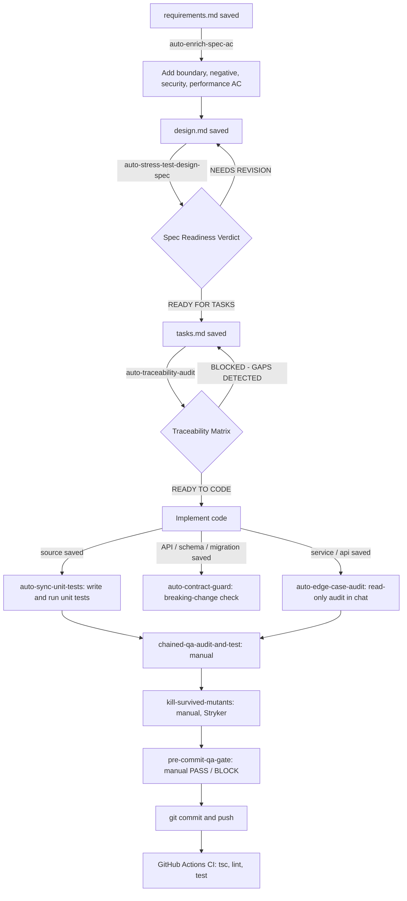

# AI-DLC Quality Engineering Pipeline (`.kiro/`)

This repository uses **Kiro IDE**, **Kiro CLI**, and **GitHub Actions** to run a shift-left Quality Engineering (QE) pipeline across the **AI-Driven Development Life Cycle (AI-DLC)**. Quality checks run at every step: spec, design, task plan, code, tests, commit, and CI.

All QA artifacts (specs, test plans, test files, audit reports) are written in English. This is enforced by `.kiro/steering/qa-documentation.md`.

---

## 1. Pipeline at a glance



Text fallback of the same flow:

```text
Spec        requirements.md  -> auto-enrich-spec-ac
Design      design.md        -> auto-stress-test-design-spec  (READY FOR TASKS / NEEDS REVISION)
Plan        tasks.md         -> auto-traceability-audit       (READY TO CODE / BLOCKED - GAPS DETECTED)
Code        source saved     -> auto-sync-unit-tests, auto-edge-case-audit, auto-contract-guard
Harden      manual           -> chained-qa-audit-and-test -> kill-survived-mutants
Commit      manual           -> pre-commit-qa-gate            (PASS / BLOCK)
Merge       push / PR        -> GitHub Actions: tsc, lint, test
```

---

## 2. Architecture overview

```text
.kiro/
├── agents/
│   ├── spec-qa-architect.json / .md        # Pre-code spec and design auditor (writes to .kiro/specs/ only)
│   ├── spec-qa-architect-prompt.md
│   ├── qa-edge-case-reviewer.json          # Read-only adversarial code auditor
│   ├── qa-edge-case-reviewer-prompt.md
│   ├── qa-test-writer.json                 # Test-only builder (writes to *.test.* / *.spec.* / tests/** only)
│   ├── qa-test-writer-prompt.md
│   ├── qa-contract-reviewer.json           # API and DB breaking-change auditor
│   └── qa-contract-reviewer-prompt.md
├── hooks/
│   ├── auto-enrich-spec-ac.kiro.hook           # requirements.md saved
│   ├── auto-stress-test-design-spec.kiro.hook  # design.md saved
│   ├── auto-traceability-audit.kiro.hook       # tasks.md saved
│   ├── auto-sync-unit-tests.kiro.hook          # source file saved
│   ├── auto-edge-case-audit.kiro.hook          # service / api file saved
│   ├── auto-contract-guard.kiro.hook           # API route, schema, OpenAPI, migration saved
│   ├── chained-qa-audit-and-test.kiro.hook     # manual: Reviewer -> Test-Writer
│   ├── kill-survived-mutants.kiro.hook         # manual: Stryker mutation hardening
│   └── pre-commit-qa-gate.kiro.hook            # manual: PASS / BLOCK gate
└── steering/
    ├── qa-documentation.md                 # English-only QA artifacts
    ├── qa-standards.md                     # AAA pattern, 4 scenario categories, no .skip / .only
    ├── spec-qa-enrichment.md               # 5 acceptance-criteria dimensions (EARS)
    ├── spec-traceability-gate.md           # 100% requirement -> task traceability
    └── api-contract-standards.md           # Additive-only API evolution, contract tests
```

### Agents (personas)

| Agent | Role | Permissions |
|---|---|---|
| `spec-qa-architect` | Stress-tests `requirements.md` and `design.md` | Writes only under `.kiro/specs/` |
| `qa-edge-case-reviewer` | Audits code for boundaries, nulls, races, state gaps, timeouts, test blind spots | Read-only. Shell limited to `git diff`, `git status`, test runners |
| `qa-test-writer` | Turns audit findings into tests and kills survived mutants | Writes only test files. Shell limited to test runners and `stryker run` |
| `qa-contract-reviewer` | Detects breaking API, DTO, OpenAPI, and migration changes | Read-only. Shell limited to `git diff`, `git status`, contract tests |

### Steering files

| File | Applies to | Enforces |
|---|---|---|
| `qa-documentation.md` | Always | English-only QA artifacts. Adds an **Edge Cases & Negative Scenarios** subsection to specs |
| `qa-standards.md` | `**/*.{test,spec}.{ts,tsx,js,jsx}` | Arrange-Act-Assert, `should ... when ...` naming, Happy / Boundary / Negative / External-failure coverage, mocked I/O, no `.skip` or `.only`, 100% pass |
| `spec-qa-enrichment.md` | `.kiro/specs/**/requirements.md` | Happy path, boundary, negative, security, and performance criteria in EARS syntax |
| `spec-traceability-gate.md` | `.kiro/specs/**/tasks.md` | Every AC and design safeguard maps to a task with a test sub-task |
| `api-contract-standards.md` | `src/{api,routes,controllers,schemas}/**/*.ts` | Additive-only changes, stable status codes, `*.contract.test.ts` per endpoint |

---

## 3. Stage-by-stage flow

### Stage 1. Requirements (automatic)
- **Trigger:** `.kiro/specs/**/requirements.md` is saved.
- **Hook:** `auto-enrich-spec-ac`.
- **Action:** Checks every user story for Boundary, Negative, Security, and Performance criteria. Appends any missing ones in EARS form (`WHEN ... THE SYSTEM SHALL ...`). Existing content is never deleted.
- **Output:** Enriched `requirements.md`, or a confirmation that the spec is QA-ready.

### Stage 2. Design (automatic)
- **Trigger:** `.kiro/specs/**/design.md` is saved.
- **Hook:** `auto-stress-test-design-spec` (persona `spec-qa-architect`).
- **Action:** Audits requirement traceability, concurrency and idempotency, AppSec and IDOR risks, and scale bottlenecks. It does not edit the files.
- **Output:** **Spec Readiness Verdict**: `READY FOR TASKS` or `NEEDS REVISION`, with a proposed spec patch for the team to approve.

### Stage 3. Task plan (automatic gate)
- **Trigger:** `.kiro/specs/**/tasks.md` is saved.
- **Hook:** `auto-traceability-audit`.
- **Action:** Maps every acceptance criterion and design safeguard to a task and a test sub-task.
- **Output:** Traceability Matrix with `COVERED` / `MISSING` per row, and a verdict: `READY TO CODE` (0 missing) or `BLOCKED - GAPS DETECTED`. It does not edit `tasks.md` until you approve.

### Stage 4. Implementation (automatic, on every save)
| Hook | Fires on | Behavior |
|---|---|---|
| `auto-sync-unit-tests` | `src/**/*.ts` (excluding tests and `.d.ts`) | Finds or creates the matching test file, covers modified logic, boundaries, and error paths, runs that file, and fixes assertions until all pass. Source is changed only if a test exposes a real bug |
| `auto-edge-case-audit` | `src/api/**`, `src/services/**` | `qa-edge-case-reviewer` posts an **Edge-Case Audit Summary** in chat. No files are modified |
| `auto-contract-guard` | API routes, schemas, OpenAPI, migrations, `prisma/schema.prisma` | `qa-contract-reviewer` posts a verdict: `SAFE (NON-BREAKING)` or `BREAKING CHANGE DETECTED` |

The edge-case reviewer checks six categories: off-by-one and thresholds, nullability and malformed input, concurrency and double submission, state-transition gaps, external timeouts, and test-suite blind spots.

### Stage 5. Hardening (manual, from the Kiro Agent Hooks panel)
1. **`chained-qa-audit-and-test`** runs two phases on uncommitted changes:
   - Phase 1: `qa-edge-case-reviewer` audits (read-only).
   - Phase 2: `qa-test-writer` implements every uncovered case in test files only, then runs the tests.
   - A failing new test means a real production bug. The test is kept and reported, never weakened.
2. **`kill-survived-mutants`** runs StrykerJS on changed `src/services/**` and `src/api/**` files. `qa-test-writer` then strengthens assertions until the mutation score is above 85%.
   - CLI equivalents: `npm run test:mutation`, `npm run test:mutation:incremental`, `npm run qa:kill-mutants`.

### Stage 6. Pre-commit gate (manual)
- **Hook:** `pre-commit-qa-gate`.
- **Checks:** no hardcoded secrets or PII in logs, input validation (for example Zod) and safe error handling, updated tests with no `.skip` / `.only`, and a clean run of lint, type-check, and the full test suite.
- **Output:** `PASS` or `BLOCK` with file and line references. It never commits for you.

### Stage 7. CI (automatic)
`.github/workflows/ci.yml` runs on push and pull request to `main`, in `web/`:
1. `npm ci`
2. `npx tsc --noEmit`
3. `npm run lint`
4. `npm test`

---

## 4. Roles and responsibilities

| Concern | Who or what | Cannot do |
|---|---|---|
| Specs and design | `spec-qa-architect` | Edit code |
| Finding defects | `qa-edge-case-reviewer`, `qa-contract-reviewer` | Edit any file |
| Writing tests | `qa-test-writer` | Edit production source |
| Fixing production bugs | Developer | n/a |
| Final decision to commit | Developer, guided by the PASS / BLOCK verdict | n/a |

---

## 5. Daily usage

| Goal | Action |
|---|---|
| Write or update a spec | Edit `requirements.md`, then `design.md`, then `tasks.md` under `.kiro/specs/<feature>/`. Read each hook verdict in chat before moving on |
| Code a feature | Save source files. Unit tests, edge-case audit, and contract checks run automatically |
| Close test gaps before a PR | Run the **Chained QA Audit -> Test Writer** hook |
| Strengthen weak assertions | Run the **Mutation Test & Harden Assertions** hook |
| Check before committing | Run the **Pre-Commit QA & Security Gate** hook and resolve every `BLOCK` item |
| Run tests manually | `cd web && npm test` |
| Run the Kiro CLI test writer | `kiro-cli chat --agent qa-test-writer --no-interactive "<prompt>"` |

Disable a hook by setting `"enabled": false` in its `.kiro.hook` file.

---

## 6. Known gaps and setup notes

- **Hook paths:** the file patterns use `src/**`, but the web app lives in `web/src/**`. Update the patterns to `web/src/**` (or move the app) before the code-level hooks fire for this project.
- **Steering reference:** the agent configs list `.kiro/steering/tech.md` as a resource, but that file does not exist yet. Add it or remove the reference.
- **Mutation testing:** `@stryker-mutator/*` is listed in the root `package.json`, but no `stryker.conf.*` exists. Add one, with the Vitest runner pointed at `web/`, before using `kill-survived-mutants`. The output folder `.kiro/tmp/` is also not created yet.
- **Husky:** no `.husky/` directory exists, so there is no git-level enforcement. Today the pre-commit gate is a manual Kiro hook. Add a Husky `pre-commit` hook running lint, type-check, and tests if you want it enforced for every contributor.
- **CI scope:** CI runs type-check, lint, and unit tests only. Mutation testing and contract tests are not part of CI.
