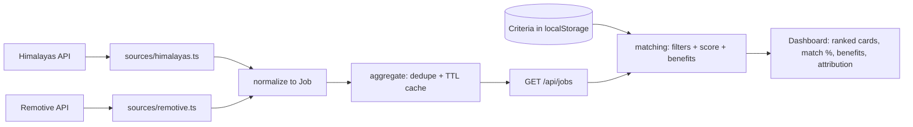

# AIventure – PoC Bootstrap Specification

> Product context lives in [README.md](./README.md). This document is the technical spec a developer or agent follows to scaffold and build the 2-day MVP without further decisions.

**Status:** Draft v1 · **Target:** functional PoC in 2 days · **App folder:** `web/`

---

## 1. Overview & Scope

AIventure pulls remote job listings from public job APIs, normalizes them into one model, scores each job against the user's criteria with deterministic matching and benefit-analysis functions, and shows a ranked recommendation dashboard.

### Goals (MVP)

| # | Goal | README deliverable |
|---|------|--------------------|
| G1 | Ingest and normalize jobs from **Himalayas** and **Remotive** APIs into one `Job` model | Multi-Source Web Data Aggregator |
| G2 | Score every job 0–100 against user criteria, with a per-factor breakdown and detected company benefits | Job-Matching & Benefit Analysis Engine |
| G3 | MUI dashboard meeting **WCAG 2.2 AA**, showing ranked jobs, match %, salary, benefit breakdown, and source attribution | Job Recommendation Dashboard |

### Non-goals (MVP)

- **No AI / LLM.** Matching and benefit analysis are our own deterministic functions. AI scoring is a later phase (see §15).
- **No authentication, no user accounts.** (Remotive terms also forbid gating listings behind signups or email capture.)
- **No database.** Criteria live in browser `localStorage`; jobs are cached in server memory.
- **No HTML scraping.** Only the official public JSON APIs are used.
- No currency conversion, no job-alert emails, no redistribution of job data (feeds, sitemaps, `JobPosting` structured data).

---

## 2. Tech Stack

| Concern | Choice | Notes |
|---------|--------|-------|
| Runtime | Node.js **20 LTS or newer** | Required by Next.js |
| Framework | **Next.js 15+ (App Router)**, scaffolded with `create-next-app@latest` | Frontend pages + backend route handlers in one app |
| Language | **TypeScript**, `strict: true` | |
| UI library | **MUI (Material UI), latest stable** with `@mui/icons-material` | All UI is built from MUI components; no Tailwind |
| Styling | Emotion (MUI default) via `@mui/material-nextjs` `AppRouterCacheProvider`; one custom theme in `src/theme.ts` | Styling uses the theme, `sx` and `styled()` only |
| Accessibility | **WCAG 2.2 Level AA** | Binding requirement for every screen and component (§10.5) |
| Validation | **Zod** | Validates every external API response and the stored criteria |
| Unit tests | **Vitest** (`node` for logic, `jsdom` for components) | Pure-function, route and component tests |
| Component / a11y tests | **@testing-library/react** + **axe-core** | Automated WCAG checks on rendered components (§13) |
| Lint | ESLint (Next.js config) | `npm run lint` |
| Package manager | npm | |

Runtime dependencies beyond Next.js and React: `@mui/material`, `@mui/icons-material`, `@mui/material-nextjs`, `@emotion/react`, `@emotion/styled`, `@emotion/cache`, `zod`. HTML stripping and salary parsing are implemented in-house (small, tested functions).

---

## 3. Folder Structure

The Next.js app lives in `web/` because the repo root already holds AI-DLC files (`.kiro/`, `aidlc/`, `AGENTS.md`) and `create-next-app` refuses non-empty folders.

```text
AIventure/
├── README.md                 # product brief (unchanged)
├── SPEC.md                   # this file
└── web/
    ├── .env.example
    ├── vitest.config.ts
    ├── src/
    │   ├── theme.ts                      # MUI theme ('use client'), AA-contrast palette (§10.5)
    │   ├── app/
    │   │   ├── layout.tsx                # <html lang="en">, AppRouterCacheProvider, ThemeProvider, CssBaseline
    │   │   ├── page.tsx                  # dashboard (client component shell)
    │   │   └── api/
    │   │       └── jobs/
    │   │           └── route.ts          # GET /api/jobs
    │   ├── components/
    │   │   ├── SkipLink.tsx
    │   │   ├── LiveAnnouncer.tsx             # polite aria-live region for result updates
    │   │   ├── CriteriaForm.tsx
    │   │   ├── JobList.tsx
    │   │   ├── JobCard.tsx
    │   │   ├── JobDetailPanel.tsx
    │   │   ├── ScoreBreakdown.tsx
    │   │   ├── BenefitChips.tsx
    │   │   ├── SourceStatusBanner.tsx
    │   │   └── SourceAttribution.tsx
    │   ├── hooks/
    │   │   └── useCriteria.ts            # localStorage persistence
    │   └── lib/
    │       ├── types.ts                  # Job, Criteria, MatchResult, SourceStatus
    │       ├── config.ts                 # weights, TTL, page limits, benefit dictionary import
    │       ├── sources/
    │       │   ├── himalayas.ts          # fetch + Zod schema + toJob()
    │       │   └── remotive.ts           # fetch + Zod schema + toJob()
    │       ├── normalize/
    │       │   ├── html.ts               # stripHtml()
    │       │   ├── employment.ts         # normalizeEmploymentType()
    │       │   ├── seniority.ts          # normalizeSeniority(), inferSeniorityFromTitle()
    │       │   ├── location.ts           # parseRemotiveLocation()
    │       │   └── timezone.ts           # parseUtcOffset()
    │       ├── aggregate/
    │       │   ├── aggregate.ts          # aggregateJobs()
    │       │   ├── dedupe.ts             # dedupeJobs()
    │       │   └── cache.ts              # TTL cache on globalThis
    │       └── matching/
    │           ├── criteria.ts           # CriteriaSchema, DEFAULT_CRITERIA, storage key
    │           ├── salary.ts             # parseSalaryText(), annualize()
    │           ├── benefits.ts           # BENEFIT_DICTIONARY, extractBenefits()
    │           ├── filters.ts            # applyHardFilters()
    │           └── score.ts              # scoreJob(), rankJobs()
    └── tests/
        ├── fixtures/
        │   ├── himalayas-browse.json
        │   ├── himalayas-search.json
        │   └── remotive.json
        ├── sources.himalayas.test.ts
        ├── sources.remotive.test.ts
        ├── normalize.test.ts
        ├── salary.test.ts
        ├── benefits.test.ts
        ├── filters.test.ts
        ├── score.test.ts
        ├── aggregate.test.ts
        ├── route.jobs.test.ts
        └── a11y/
            ├── axe.ts                    # runAxe(container) helper (WCAG 2.2 AA rule tags)
            ├── JobCard.a11y.test.tsx
            ├── CriteriaForm.a11y.test.tsx
            ├── JobDetailPanel.a11y.test.tsx
            └── Dashboard.a11y.test.tsx
```

Imports use the `@/` alias (`@/lib/...`) that `create-next-app --src-dir` configures.

---

## 4. Normalized `Job` Model

### 4.1 Types (`src/lib/types.ts`)

```ts
export type SourceName = "himalayas" | "remotive";

export type EmploymentType =
  | "full_time" | "part_time" | "contract" | "temporary" | "internship" | "other";

export type Seniority = "entry" | "mid" | "senior" | "manager" | "director" | "executive";

export type SalaryPeriod = "hourly" | "weekly" | "fortnightly" | "monthly" | "annual";

export interface Salary {
  min: number | null;        // in `period` units
  max: number | null;
  currency: string | null;   // ISO 4217, e.g. "USD"
  period: SalaryPeriod;      // default "annual"
  annualMin: number | null;  // derived via annualize()
  annualMax: number | null;
  raw: string | null;        // original free text (Remotive) or null
}

export interface JobLocation {
  worldwide: boolean;        // true = no country restriction
  countries: string[];       // ISO 3166-1 alpha-2, upper case
  regions: string[];         // e.g. "EUROPE", "AMERICAS" (Remotive text only)
  raw: string | null;        // original text (Remotive) or null
}

export interface Job {
  id: string;                    // `${source}:${sourceId}`
  source: SourceName;
  sourceId: string;
  title: string;
  company: string;
  companyLogo: string | null;
  applyUrl: string;              // official source URL – the ONLY link used for Apply
  sourceUrl: string;             // link back to the listing on the source site
  employmentType: EmploymentType | null;
  seniority: Seniority[];        // empty = unknown
  salary: Salary | null;         // null = not provided / unparseable
  location: JobLocation;
  timezones: number[] | null;    // UTC offsets in hours; [] = all timezones; null = unknown
  categories: string[];
  tags: string[];
  excerpt: string | null;
  descriptionHtml: string;       // stored, never rendered as HTML (see §10.4)
  descriptionText: string;       // stripHtml(descriptionHtml), used for matching
  publishedAt: string;           // ISO 8601
  expiresAt: string | null;      // ISO 8601
  alsoOn: { source: SourceName; url: string }[]; // filled by dedupe (§5.4)
}

export interface SourceStatus {
  name: SourceName;
  ok: boolean;
  count: number;
  cached: boolean;
  error?: string;
}
```

### 4.2 Field mapping

`unix(s)` = `new Date(s * 1000).toISOString()`.

| `Job` field | Himalayas (`jobs[]`) | Remotive (`jobs[]`) |
|-------------|----------------------|---------------------|
| `id` | derived: `himalayas:${guid}` | derived: `remotive:${id}` |
| `source` | constant `"himalayas"` | constant `"remotive"` |
| `sourceId` | `guid` | `String(id)` |
| `title` | `title` | `title` |
| `company` | `companyName` | `company_name` |
| `companyLogo` | `companyLogo` or null | `company_logo` or null |
| `applyUrl` | `applicationLink` (**required by terms**) | `url` |
| `sourceUrl` | `guid` (Himalayas job page URL) | `url` |
| `employmentType` | `normalizeEmploymentType(employmentType)` | `normalizeEmploymentType(job_type)` |
| `seniority` | `normalizeSeniority(seniority[])` | derived: `inferSeniorityFromTitle(title)` |
| `salary` | `{min: minSalary, max: maxSalary, currency, period: salaryPeriod ?? "annual", raw: null}`; null if both min and max are null | `parseSalaryText(salary)` (§4.3); null if unparseable |
| `location` | `{worldwide: locationRestrictions.length === 0, countries: locationRestrictions.map(l => l.alpha2), regions: [], raw: null}` | `parseRemotiveLocation(candidate_required_location)` (§4.4) |
| `timezones` | `timezoneRestrictions.map(parseUtcOffset)`; `[]` = all | `null` (unknown) |
| `categories` | `[...categories, ...parentCategories]` (deduped) | `[category]` |
| `tags` | `[]` | `tags` |
| `excerpt` | `excerpt` | null |
| `descriptionHtml` | `description` | `description` |
| `descriptionText` | derived: `stripHtml(description)` | derived: `stripHtml(description)` |
| `publishedAt` | `unix(pubDate)` | `new Date(publication_date + "Z").toISOString()` (value has no offset; treat as UTC) |
| `expiresAt` | `unix(expiryDate)` or null | null |
| `alsoOn` | `[]` (filled by dedupe) | `[]` (filled by dedupe) |

**Employment type mapping** (`normalize/employment.ts`, case-insensitive):

| Source value | Normalized |
|--------------|------------|
| Himalayas `Full Time`, Remotive `full_time` | `full_time` |
| `Part Time`, `part_time` | `part_time` |
| `Contractor`, `contract`, `freelance` | `contract` |
| `Temporary` | `temporary` |
| `Intern`, `internship` | `internship` |
| `Volunteer`, `Other`, `other`, anything else | `other` |
| empty / missing | `null` |

**Seniority mapping** (`normalize/seniority.ts`):

- Himalayas: `Entry-level`→`entry`, `Mid-level`→`mid`, `Senior`→`senior`, `Manager`→`manager`, `Director`→`director`, `Executive`→`executive`.
- Remotive (title regex, first match wins): `/\b(chief|vp|vice president|cto|ceo|cfo)\b/i`→`executive`; `/\b(director|head of)\b/i`→`director`; `/\bmanager\b/i`→`manager`; `/\b(senior|sr\.?|lead|principal|staff)\b/i`→`senior`; `/\b(junior|jr\.?|entry|graduate|intern)\b/i`→`entry`; `/\b(mid|intermediate)\b/i`→`mid`; otherwise `[]`.

The ordinal ladder used for scoring is `entry < mid < senior < manager < director < executive`.

### 4.3 Salary parsing (`matching/salary.ts`)

`parseSalaryText(raw: string | null | undefined): Salary | null` handles Remotive free text:

1. Empty, or matches `/competitive|doe|negotiable|tbd/i` with no digits → `null`.
2. Currency: symbol or code. `$`→`USD`, `€`→`EUR`, `£`→`GBP`, `₹`→`INR`, or an explicit `USD|EUR|GBP|CAD|AUD|INR|SGD|...` token. No currency found → `currency: null`.
3. Numbers: extract up to two numbers; remove thousands separators (`,` `.` `space` when followed by 3 digits); `k`/`K` suffix ×1,000; `m`/`M` ×1,000,000. One number → `min = max`.
4. Period: `/\b(per hour|\/hr|\/hour|hourly|an hour)\b/i`→`hourly`; `week`→`weekly`; `month|\/mo`→`monthly`; otherwise `annual`.
5. Sanity check: a computed `annualMax` below 1,000 or above 10,000,000 → return `null`.

`annualize(amount, period)` multiplies by: hourly ×2080, weekly ×52, fortnightly ×26, monthly ×12, annual ×1. It is used by both sources to fill `annualMin` / `annualMax`.

| Input | Output (min, max, currency, period) |
|-------|-------------------------------------|
| `"$170k - $200k"` | 170000, 200000, USD, annual |
| `"USD 100,000 - 120,000"` | 100000, 120000, USD, annual |
| `"€60k"` | 60000, 60000, EUR, annual |
| `"$50 - $70 /hr"` | 50, 70, USD, hourly (annual 104000–145600) |
| `"Competitive"` | `null` |
| `""` | `null` |

### 4.4 Remotive location parsing (`normalize/location.ts`)

`candidate_required_location` is free text, e.g. `"Worldwide"`, `"USA, Canada, USA timezones"`, `"Europe"`.

- `worldwide = true` if the text is empty or matches `/worldwide|anywhere|global/i`.
- Split on `,`, `/`, ` or `, `;`. Each token is matched against:
  - a country table (`name → alpha2`, including aliases `USA`, `US`, `United States`, `UK`, `United Kingdom`, ...) → `countries`;
  - a region table (`Europe/EU/EMEA → EUROPE`, `Americas/North America/LATAM → AMERICAS`, `APAC/Asia → APAC`) → `regions`.
- Tokens containing `timezone` are ignored for location.
- Keep the original string in `raw`.

### 4.5 Time zone parsing (`normalize/timezone.ts`)

`parseUtcOffset(s: string): number | null` accepts `"-5"`, `"+7"`, `"UTC-05:00"`, `"GMT+5:30"` and returns hours (e.g. `5.5`). Unparseable values are dropped. **Verify the real Himalayas format against the first recorded fixture** and adjust.

---

## 5. Data Sources & Aggregation

### 5.1 Himalayas (`sources/himalayas.ts`)

Docs: <https://himalayas.app/docs/remote-jobs-api> · OpenAPI: <https://himalayas.app/docs/openapi.json>

| Item | Value |
|------|-------|
| Browse | `GET https://himalayas.app/jobs/api?limit=20[&cursor=<nextCursor>]` |
| Search | `GET https://himalayas.app/jobs/api/search?q=<text>[&page=<n>]` (also `country`, `worldwide`, `exclude_worldwide`, `seniority`, `employment_type`, `company`, `timezone`, `sort` such as `recent` or `salaryDesc`) |
| Single job (open check, optional) | `GET https://himalayas.app/jobs/api/companies/:company/jobs/:slug` → 200 open, 410 closed, 404 not found |
| Page size | `limit` max **20** (default 20) |
| Pagination | Browse: pass back `nextCursor` as `cursor`; absent `nextCursor` = last page. Treat the cursor as opaque. `offset` is deprecated, do not use. Search: 1-based `page`. |
| Response | `{ updatedAt, nextCursor?, offset, limit, totalCount, jobs[] }` |
| Auth | None required. Optional free key → header `Authorization: Bearer ${HIMALAYAS_API_KEY}` (**server only**, never in browser code, URLs or logs). |
| Limits | Keyed: 60 req/min, 10,000/day. Unkeyed: shared public allowance. Cached responses do not count. |
| Refresh | Data refreshes every 24 h; no benefit in polling more often. |
| Errors | 400 bad params/cursor, 401 bad key, 404, 410, 429 (keyed responses include `Retry-After` seconds), 503 retry shortly |

Fetch policy:

- Without `q`: walk the browse endpoint up to `HIMALAYAS_MAX_PAGES` pages (default **5** → up to 100 jobs).
- With `q`: call search pages 1..`HIMALAYAS_MAX_PAGES` until a page returns no jobs.
- Validate each response with a Zod schema. Use `.passthrough()` on job objects and make optional fields `.nullish()` so new fields do not break parsing. A job that fails validation is skipped and counted in a `skipped` log line. It does not fail the whole source.

### 5.2 Remotive (`sources/remotive.ts`)

Docs/terms: <https://remotive.com/remote-jobs/api> · ToS: <https://remotive.com/api-documentation>

| Item | Value |
|------|-------|
| Endpoint | `GET https://remotive.com/api/remote-jobs` |
| Params | `search`, `category`, `company_name`, `limit` (**to verify**: a test call with `limit=1` returned all 17 jobs) |
| Response | `{ "00-warning", "0-legal-notice", "job-count", "total-job-count", jobs[] }` |
| Job fields | `id`, `url`, `title`, `company_name`, `company_logo`, `category`, `tags[]`, `job_type`, `publication_date` (ISO without offset, e.g. `2026-11-14T20:33:53`), `candidate_required_location`, `salary` (free text, e.g. `$170k - $200k`), `description` (HTML) |
| Auth | None |
| Limits | API notice advises **max 4 requests per day**; excessive requests are blocked. |
| Freshness | Public jobs are delayed 24 h. |

Endpoint and field names were confirmed with one live call on 2026-11-17. Field optionality and the `limit` behaviour are **still to verify on first call**. Record that response as `tests/fixtures/remotive.json`.

Fetch policy: **always fetch the full feed once per cache window, without `search`**. Apply `q` locally, so different queries never cost extra Remotive calls. The public feed was small at verification time (17 jobs), so most of the job volume comes from Himalayas.

### 5.3 Aggregation (`aggregate/aggregate.ts`)

```ts
aggregateJobs(opts: { q?: string }): Promise<{
  jobs: Job[]; sources: SourceStatus[]; fetchedAt: string;
}>
```

1. Run `fetchHimalayas(q)` and `fetchRemotive()` in parallel with `Promise.allSettled`. Each goes through the cache (§5.5).
2. A rejected source → `SourceStatus { ok: false, count: 0, error: <short message> }`; the other source's jobs are still returned (**partial results**).
3. If `q` is set, filter locally on Remotive jobs (and as a safety net on all jobs): case-insensitive match of every `q` token in `title + company + tags + categories + descriptionText`.
4. `dedupeJobs()` (§5.4), then sort by `publishedAt` descending.
5. Drop jobs whose `expiresAt` is in the past.

### 5.4 Dedupe (`aggregate/dedupe.ts`)

- Key = `norm(company) + "|" + norm(title)`. `norm` lower-cases the text, strips punctuation, collapses whitespace, and removes company suffixes (`inc`, `ltd`, `llc`, `gmbh`).
- On collision, keep the **Himalayas** record because its salary is structured. Push the other record's `{source, url}` into `alsoOn`, so both sources stay credited and linked.

### 5.5 Cache (`aggregate/cache.ts`)

- In-memory `Map<string, { value, expiresAt, fetchedAt }>` stored on `globalThis.__aiventureCache`, so it survives dev hot reloads.
- Keys: `himalayas:browse`, `himalayas:search:<q>`, `remotive:all`.
- TTL = `CACHE_TTL_SECONDS` (default **21600** = 6 h; fits Remotive's 4/day guidance).
- **Stale-on-error:** if a refresh fails and a stale entry exists, return the stale data with `SourceStatus.cached = true` and `error` set.
- **In-flight dedupe:** concurrent requests for the same key share one pending promise.
- 429 handling: read `Retry-After` (default 60 s), and don't call that source again before then (store `blockedUntil` per source). Never retry in a tight loop inside a request. Return stale data or a failed status instead.
- Upstream `fetch` timeout: `AbortSignal.timeout(10_000)`.
- The cache is per server process. That is fine for a local or single-instance PoC.

### 5.6 Environment (`web/.env.example`)

```bash
# Optional: free key from https://himalayas.app/api-keys (server-side only)
HIMALAYAS_API_KEY=
# Cache lifetime for upstream responses, seconds (default 6h)
CACHE_TTL_SECONDS=21600
# Max Himalayas pages per refresh (20 jobs/page)
HIMALAYAS_MAX_PAGES=5
```

Copy to `web/.env.local` (git-ignored by Next.js defaults). Never prefix these with `NEXT_PUBLIC_`.

---

## 6. Criteria Model (`matching/criteria.ts`)

```ts
import { z } from "zod";

export const CRITERIA_STORAGE_KEY = "aiventure.criteria.v1";

export const BenefitKey = z.enum([
  "health", "retirement", "equity", "pto", "parental_leave",
  "learning", "home_office", "flexible_hours", "wellness",
]);

export const CriteriaSchema = z.object({
  version: z.literal(1),
  keywords: z.array(z.string().trim().min(1)).max(30),          // skills, e.g. "react"
  targetTitles: z.array(z.string().trim().min(1)).max(10),      // e.g. "frontend engineer"
  excludedKeywords: z.array(z.string().trim().min(1)).max(30),  // e.g. "php", "on-site"
  seniority: z.array(z.enum(["entry","mid","senior","manager","director","executive"])),
  employmentTypes: z.array(z.enum(["full_time","part_time","contract","temporary","internship","other"])),
  minSalary: z.object({ amount: z.number().positive(), currency: z.string().length(3) }).nullable(), // annual
  country: z.string().length(2).nullable(),                     // ISO alpha-2 where the user lives
  timezoneOffset: z.number().min(-12).max(14).nullable(),       // user's UTC offset in hours
  mustHaveBenefits: z.array(BenefitKey),
  niceToHaveBenefits: z.array(BenefitKey),
});
export type Criteria = z.infer<typeof CriteriaSchema>;
```

`DEFAULT_CRITERIA` has all arrays empty and all nullable fields set to `null`. With the default, every job scores 100 (§7.3), sorted by recency.

Persistence (`hooks/useCriteria.ts`):

- On mount, read `localStorage[CRITERIA_STORAGE_KEY]` and `CriteriaSchema.safeParse` it. Invalid or missing → `DEFAULT_CRITERIA`. Guard against SSR: access `localStorage` only in `useEffect`.
- On change, write the full JSON back (debounced 300 ms).
- A future schema change bumps the key to `.v2` and migrates from `.v1`.

Criteria usage map (every field is used):

| Criteria field | Used by |
|----------------|---------|
| `keywords` | score factor **skills** |
| `targetTitles` | score factor **title** |
| `excludedKeywords` | hard filter **F2** |
| `seniority` | score factor **seniority** |
| `employmentTypes` | score factor **employment** |
| `minSalary` | hard filter **F3** + score factor **salary** |
| `country` | hard filter **F1** |
| `timezoneOffset` | score factor **timezone** |
| `mustHaveBenefits`, `niceToHaveBenefits` | score factor **benefits** |

---

## 7. Matching Engine (`matching/filters.ts`, `matching/score.ts`)

All functions are **pure** (no I/O, no `Date.now()` inside), so they run identically on server and client and are trivial to unit-test.

Text helpers: `haystack(job) = lower(title + " " + tags + " " + categories + " " + descriptionText)`. A term matches when it is found with word boundaries (`\b`, regex special characters escaped). Multi-word terms match as a phrase.

### 7.1 Hard filters (`applyHardFilters(jobs, criteria) → { kept: Job[], excluded: {job, reason}[] }`)

| ID | Filter | Rule | When skipped |
|----|--------|------|--------------|
| F1 | Location eligibility | Keep if `location.worldwide`, or `country` ∈ `location.countries`, or `country`'s region ∈ `location.regions`. If the Remotive text was unparseable (no countries, no regions, not worldwide), **keep** and mark `locationUncertain`. | `country` is null |
| F2 | Excluded keywords | Exclude if any `excludedKeywords` term matches `haystack(job)`. | list empty |
| F3 | Salary floor | Exclude only if salary is **known**, currency equals `minSalary.currency`, and `salary.annualMax < minSalary.amount`. | `minSalary` null, salary unknown, or currency differs |

Excluded jobs are counted and can be revealed with a "Show excluded (n)" toggle that lists each reason.

### 7.2 Weights (`config.ts`)

| Factor | Key | Weight |
|--------|-----|-------:|
| Skills / keywords | `skills` | 30 |
| Title | `title` | 20 |
| Seniority | `seniority` | 10 |
| Salary | `salary` | 15 |
| Employment type | `employment` | 5 |
| Timezone | `timezone` | 5 |
| Benefits | `benefits` | 15 |
| **Total** | | **100** |

A unit test asserts the weights sum to 100.

### 7.3 Factor scores (each 0..1)

| Factor | Active when | Score |
|--------|-------------|-------|
| skills | `keywords.length > 0` | `matchedKeywords / keywords.length` |
| title | `targetTitles.length > 0` | 1 if any target phrase appears in `title`; otherwise the best token overlap: max over targets of `(target tokens found in title) / (target tokens)` |
| seniority | `seniority.length > 0` | 1 if the job's levels intersect; 0.5 if the nearest level is 1 step away on the ladder, **or** the job seniority is unknown; else 0 |
| salary | `minSalary` set | 1 if `annualMin ≥ amount`; 0.75 if `annualMin < amount ≤ annualMax` (or only `annualMax` known and `≥ amount`); 0.5 if salary unknown or currency differs |
| employment | `employmentTypes.length > 0` | 1 if `employmentType` ∈ list; 0.5 if null; else 0 |
| timezone | `timezoneOffset` set | 1 if `timezones` is `[]` (all) or contains a value within 0.5 h of the user's offset; 0.5 if the nearest is within 2 h **or** `timezones` is null (unknown); else 0 |
| benefits | any benefit list non-empty | `(2 × mustFound + niceFound) / (2 × mustTotal + niceTotal)` |

**Formula:** with `A` the set of active factors,

```text
matchPercent = round( 100 × Σ_{f∈A} w_f × s_f  /  Σ_{f∈A} w_f )
```

If `A` is empty, `matchPercent = 100`. Inactive factors are excluded instead of being given a neutral score, so an empty criterion never inflates or deflates the match.

### 7.4 Output

```ts
export interface FactorResult {
  key: "skills" | "title" | "seniority" | "salary" | "employment" | "timezone" | "benefits";
  weight: number;
  active: boolean;
  score: number;          // 0..1
  points: number;         // weight × score (before normalization)
  detail: string;         // human-readable, e.g. "3/4 skills: react, typescript, node"
}

export interface MatchResult {
  jobId: string;
  matchPercent: number;   // 0..100 integer
  factors: FactorResult[];
  benefits: DetectedBenefit[];   // from §8
  locationUncertain: boolean;
}

scoreJob(job: Job, criteria: Criteria): MatchResult
rankJobs(jobs: Job[], criteria: Criteria): { ranked: (Job & { match: MatchResult })[]; excluded: { job: Job; reason: string }[] }
```

`rankJobs` = `applyHardFilters` → `scoreJob` per job → sort by `matchPercent` desc. Ties are broken by `publishedAt` desc.

### 7.5 Worked example

**Criteria:** keywords `react, typescript, node, graphql`; targetTitles `frontend engineer`; seniority `senior`; employmentTypes `full_time`; minSalary `100000 USD`; country `VN`; timezoneOffset `+7`; mustHave `health, pto`; niceToHave `learning, equity`; excludedKeywords `php`.

**Job (Himalayas):** "Senior Frontend Engineer". The description mentions React, TypeScript and Node.js but not GraphQL. Seniority `senior`, `full_time`, salary 120,000–150,000 USD annual, `locationRestrictions: []` (worldwide), `timezoneRestrictions: ["+3","+4","+5","+6"]`. Benefits text mentions health insurance, unlimited PTO and a learning budget. No equity. No "php".

Hard filters: F1 passes (worldwide). F2 passes (no "php"). F3 passes (150,000 ≥ 100,000).

| Factor | Weight | Score | Points | Reason |
|--------|-------:|------:|-------:|--------|
| skills | 30 | 0.75 | 22.5 | 3/4 matched (graphql missing) |
| title | 20 | 1.00 | 20.0 | "frontend engineer" found in title |
| seniority | 10 | 1.00 | 10.0 | senior = senior |
| salary | 15 | 1.00 | 15.0 | annualMin 120,000 ≥ 100,000 USD |
| employment | 5 | 1.00 | 5.0 | full_time |
| timezone | 5 | 0.50 | 2.5 | nearest +6 is 1 h from +7 |
| benefits | 15 | 0.8333 | 12.5 | must 2/2, nice 1/2 → (4+1)/(4+2) |
| **Total** | **100** | | **87.5** | all factors active |

`matchPercent = round(100 × 87.5 / 100) = 88%`.

Add this exact case to `tests/score.test.ts` as a golden test.

---

## 8. Benefit Analysis (`matching/benefits.ts`)

`extractBenefits(job: Job): DetectedBenefit[]` runs a regex dictionary over `job.descriptionText` (already HTML-stripped; also include `excerpt`).

```ts
export interface DetectedBenefit {
  key: BenefitKey;          // see §6
  label: string;            // display name
  evidence: string[];       // up to 2 snippets, ±60 chars around each match, whitespace-collapsed
}
```

| Key | Label | Patterns (case-insensitive, word-bounded) |
|-----|-------|-------------------------------------------|
| `health` | Health / Medical | `health insurance`, `medical`, `dental`, `vision`, `health care`, `healthcare coverage`, `private health` |
| `retirement` | Retirement | `401\(?k\)?`, `pension`, `retirement`, `superannuation`, `rrsp` |
| `equity` | Equity | `equity`, `stock options?`, `rsus?`, `esop`, `shares` |
| `pto` | Paid time off | `pto`, `paid time off`, `unlimited vacation`, `unlimited holidays?`, `\d+ days (of )?(paid )?vacation`, `\d+ days (of )?(paid )?holidays?`, `\d+ days (of )?(paid )?leave`, `annual leave` |
| `parental_leave` | Parental leave | `parental leave`, `maternity`, `paternity`, `family leave` |
| `learning` | Learning budget | `learning budget`, `learning stipend`, `education budget`, `education allowance`, `conference`, `training budget`, `professional development`, `courses` |
| `home_office` | Home-office stipend | `home office stipend`, `home office budget`, `home office allowance`, `equipment budget`, `equipment stipend`, `co-?working`, `internet stipend` |
| `flexible_hours` | Flexible hours | `flexible hours`, `flexible schedule`, `flexible working hours`, `async`, `asynchronous`, `work-life balance` |
| `wellness` | Wellness | `wellness`, `wellbeing`, `well-being`, `gym`, `mental health`, `fitness` |

Patterns are listed separately to keep the table readable. Implement each row as one case-insensitive regex that joins the patterns with alternation.

Rules:

- One `DetectedBenefit` per key, at most. Evidence snippets come from the first two distinct matches.
- `stripHtml()` (`normalize/html.ts`): replace `<br>`, `</p>` and `</li>` with newlines, remove all other tags, decode common entities (`&amp; &lt; &gt; &quot; &#39; &nbsp;` and numeric `&#NNN;`), and collapse whitespace.
- Known false positives (e.g. "equity" in "diversity, equity & inclusion") are accepted in the MVP. Add a negative pattern for `diversity,? equity` as a cheap improvement.

---

## 9. API Contract

### `GET /api/jobs` (`src/app/api/jobs/route.ts`)

| Query param | Type | Default | Notes |
|-------------|------|---------|-------|
| `q` | string, ≤ 100 chars | — | Optional free-text query (Himalayas search upstream; Remotive filtered locally) |

Route settings: `export const runtime = "nodejs"; export const dynamic = "force-dynamic";` (caching is handled by §5.5, not by Next.js fetch caching).

Validate `q` with Zod (trim, max 100). Invalid input → `400 { error }`.

**Response 200** (also when one source failed; check `sources[].ok`):

```json
{
  "fetchedAt": "2026-11-17T09:00:00.000Z",
  "sources": [
    { "name": "himalayas", "ok": true,  "count": 100, "cached": false },
    { "name": "remotive",  "ok": false, "count": 0,   "cached": false, "error": "HTTP 429 (retry after 60s)" }
  ],
  "jobs": [
    {
      "id": "himalayas:https://himalayas.app/companies/acme/jobs/senior-frontend-engineer",
      "source": "himalayas",
      "sourceId": "https://himalayas.app/companies/acme/jobs/senior-frontend-engineer",
      "title": "Senior Frontend Engineer",
      "company": "Acme",
      "companyLogo": "https://cdn.himalayas.app/acme.png",
      "applyUrl": "https://himalayas.app/companies/acme/jobs/senior-frontend-engineer/apply",
      "sourceUrl": "https://himalayas.app/companies/acme/jobs/senior-frontend-engineer",
      "employmentType": "full_time",
      "seniority": ["senior"],
      "salary": { "min": 120000, "max": 150000, "currency": "USD", "period": "annual",
                  "annualMin": 120000, "annualMax": 150000, "raw": null },
      "location": { "worldwide": true, "countries": [], "regions": [], "raw": null },
      "timezones": [3, 4, 5, 6],
      "categories": ["Engineering"],
      "tags": [],
      "excerpt": "Build our React design system...",
      "descriptionHtml": "<p>...</p>",
      "descriptionText": "...",
      "publishedAt": "2026-11-16T08:00:00.000Z",
      "expiresAt": "2026-12-16T08:00:00.000Z",
      "alsoOn": []
    }
  ]
}
```

**Response 502** only when **both** sources fail and no stale cache exists. The body is `{ "error": "All sources unavailable", "sources": [...] }`.

**Scoring location:** the API returns unscored jobs. The client calls `rankJobs(jobs, criteria)` (pure, shared from `@/lib/matching/score`). Criteria then stay in the browser, and re-ranking on every form change needs no network round-trip.

Keep `descriptionHtml` in the payload (≈ 100 jobs is acceptable for a PoC). If the payload gets too large, drop it and keep only `descriptionText`.

---

## 10. Dashboard UX (`src/app/page.tsx` + `src/components/`)

### 10.1 Architecture



Text fallback: the Himalayas and Remotive APIs feed two source adapters that normalize records into `Job`. The aggregator dedupes and caches them in memory and serves them from `GET /api/jobs`. In the browser, the matching engine combines those jobs with the criteria from `localStorage` and the dashboard renders the ranked result.

### 10.2 Layout

```text
┌───────────────────────────────────────────────────────────────────────┐
│ AIventure            [search q____________] [Refresh]                 │
│ SourceStatusBanner: "Remotive unavailable – showing Himalayas only"   │
├──────────────────────┬────────────────────────────────────────────────┤
│ CriteriaForm         │ Sort: [Match ▼]  Filters: [min match 50%] [src]│
│  Skills   [chips]    │ ┌───────────────────────────────────────────┐  │
│  Titles   [chips]    │ │ JobCard  88%  Senior Frontend Engineer    │  │
│  Exclude  [chips]    │ │ Acme · Full time · USD 120k–150k/yr       │  │
│  Seniority [multi]   │ │ [Health][PTO][Learning]   Source: Himalayas│ │
│  Type      [multi]   │ └───────────────────────────────────────────┘  │
│  Min salary [__][USD]│  ... more cards ...                            │
│  Country [VN] TZ[+7] │  Show excluded (12)                            │
│  Must-have [chips]   ├────────────────────────────────────────────────┤
│  Nice-to-have[chips] │ JobDetailPanel (on card click)                 │
│  [Reset]             │  ScoreBreakdown · Benefits + evidence · Apply  │
└──────────────────────┴────────────────────────────────────────────────┘
```

Page structure uses MUI layout components: `AppBar` + `Toolbar` (inside `<header>`), `Container`, and `Grid` with the criteria column (`<aside>`) and the results column (`<main id="main">`). A `<footer>` holds the data-source credit.

On small screens (below the theme's `md` breakpoint) the criteria form moves into a MUI `Drawer` opened from a "Criteria" button in the app bar, and the detail panel opens as a full-screen `Dialog` (`fullScreen` via `useMediaQuery(theme.breakpoints.down("md"))`). On `md` and up the detail panel is a right-anchored `Drawer` (or `Dialog`). It is always modal, so focus handling is MUI's (§10.5).

### 10.3 Components

All components are client components built only from MUI primitives. Use the MUI component that already carries the right semantics instead of re-creating it with `Box` + click handlers.

| Component | MUI building blocks | Responsibility |
|-----------|---------------------|----------------|
| `SkipLink` | `Link` styled visually hidden until focused | First focusable element; "Skip to job results" → `#main` |
| `LiveAnnouncer` | `Box` with `role="status"` `aria-live="polite"`, visually hidden | Announces "Showing 42 jobs, sorted by match" after loading, re-ranking or filtering (debounced 500 ms) |
| `CriteriaForm` | `Autocomplete` (`multiple`, `freeSolo`) with `Chip` tags for keywords / titles / excluded; `Select` or `ToggleButtonGroup` for seniority and employment type; `TextField type="number"` + currency `Select` for minimum salary; `Autocomplete` for country; `Select` for UTC offset; `FormGroup` of `Checkbox` inside `FormControl component="fieldset"` + `FormLabel component="legend"` for the two benefit groups; `Button` "Reset" | Edits `Criteria` through `useCriteria`. Every control has a visible `label`; helper text explains expected input. "Reset" restores `DEFAULT_CRITERIA` after a confirm `Dialog`. |
| `JobList` | `Stack`, `Select` (sort), `Slider` (min match %, with `aria-label` and `valueLabelDisplay`), `ToggleButtonGroup` (source), `Switch` ("salary known only"), `Button` "Show excluded (n)" | Receives the output of `rankJobs`. Sort options: match % (default), newest, salary (annualMax desc, unknown last). Renders results as a list (`component="ul"`, each card in `<li>`). Uses `useMemo` on `[jobs, criteria]`. |
| `JobCard` | `Card`, `CardActionArea` (opens detail), `CardHeader` with `Avatar` (logo, `alt` = company name; initials fallback), `Chip` match badge, `Typography` | Title (`h3`), company, match badge, employment type, salary formatted as `CUR min–max/period`, location summary, `BenefitChips`, `SourceAttribution`. The match badge shows the number **and** a text level ("88% · Strong match"), never colour alone (§10.5). |
| `JobDetailPanel` | `Dialog` / `Drawer` with `DialogTitle` (`aria-labelledby`), `DialogContent`, `DialogActions`, `Button` (Apply), `Link` | Title and meta, `ScoreBreakdown`, detected benefits with evidence quotes (`<blockquote>`), description as **plain text** (`descriptionText`), Apply button, `SourceAttribution`, and the `alsoOn` links. Close button has `aria-label="Close job details"`. |
| `ScoreBreakdown` | `Table` (`caption` "Match score breakdown") with `LinearProgress variant="determinate"` per row | One row per factor: label, progress bar (`aria-label` = factor name, `aria-valuenow`), `points / weight`, `detail` text. Inactive factors show the text "not set", not only a grey style. |
| `BenefitChips` | `Stack` of `Chip` with icons from `@mui/icons-material` | One chip per detected benefit. Must-have chips use a filled variant **and** a check icon; a missing must-have uses an outlined variant, a "missing" text label and an icon. |
| `SourceStatusBanner` | `Alert severity="warning"` (or `"error"`) + `AlertTitle` + `Button` Retry | Shown when any `sources[].ok === false` or `cached === true` with an error. Names the source and its error. MUI `Alert` has `role="alert"`, so it is announced. |
| `SourceAttribution` | `Typography variant="caption"` + `Link` | `Source: <Link href={sourceUrl}>Himalayas</Link>` or `Remotive`. Always visible on every card and in the detail panel. The link text includes the job title for screen readers, e.g. `aria-label="View Senior Frontend Engineer on Himalayas (opens in new tab)"`. |

### 10.4 States & behaviour

| State | Behaviour |
|-------|-----------|
| Loading | 6 MUI `Skeleton` cards while `/api/jobs` is pending; results container has `aria-busy="true"`; `LiveAnnouncer` says "Loading jobs" |
| Empty (no jobs from API) | "No jobs available right now" + Retry |
| Empty (all filtered out) | "No jobs match your criteria" + "Show excluded (n)" + "Reset criteria" |
| Partial failure | `SourceStatusBanner` + results from the healthy source |
| Total failure (502) | Error card with the per-source errors + Retry |
| First visit | Default criteria, with a hint "Set your skills to get personalised matches" |

- **Apply** opens `applyUrl` in a new tab (`target="_blank" rel="noopener noreferrer"`). It is never rebuilt or replaced with an employer or ATS link.
- **Security:** never render `descriptionHtml` with `dangerouslySetInnerHTML`. Remotive HTML is not guaranteed to be sanitized. Render `descriptionText` in `Typography` with preserved line breaks (`sx={{ whiteSpace: "pre-line" }}`).
- No email, signup or login prompts anywhere (Remotive terms).
- Refresh calls `/api/jobs` again. The server cache decides whether upstream is hit.

### 10.5 Accessibility (WCAG 2.2 Level AA)

**Target:** conformance with [WCAG 2.2](https://www.w3.org/TR/WCAG22/) Level **A and AA** for every page, state and component. MUI components give correct roles, keyboard behaviour and focus management by default. The rules below cover what MUI does not guarantee on its own. Numbers in brackets are WCAG success criteria.

**Theme (`src/theme.ts`)**

```ts
"use client";
import { createTheme } from "@mui/material/styles";

const theme = createTheme({
  cssVariables: true,
  palette: {
    mode: "light",
    contrastThreshold: 4.5,              // MUI picks button/chip text colours with ≥ 4.5:1
    primary:   { main: "#1565c0" },      // white text 5.7:1
    success:   { main: "#1b5e20" },      // strong match badge, white text 7.9:1
    warning:   { main: "#8a4b00" },      // medium match badge (dark amber), white text 6.8:1
    error:     { main: "#c62828" },      // white text 5.6:1
  },
  components: {
    MuiLink: { defaultProps: { underline: "always" } },  // links not identified by colour alone
  },
});
export default theme;
```

Verify every colour pair in the theme with a contrast checker before Task 6 is done; the values above are starting points.

**Rules**

| Area | Requirement | WCAG SC |
|------|-------------|---------|
| Structure | `<html lang="en">`; one `h1` ("AIventure – Job matches"); headings in order (`h2` for "Criteria" and "Results", `h3` per job title) using `Typography component=` to separate visual size from level; landmarks `header`, `nav` (if any), `aside`, `main`, `footer` | 1.3.1, 2.4.6, 3.1.1 |
| Page title | `export const metadata = { title: "AIventure – Job matches" }` in `layout.tsx` | 2.4.2 |
| Skip link | `SkipLink` to `#main`, first in tab order, visible on focus | 2.4.1 |
| Keyboard | Everything works with keyboard only: Tab/Shift+Tab order follows the visual order; cards open with Enter/Space (`CardActionArea`); dialogs close with Esc; no keyboard traps; no positive `tabIndex` | 2.1.1, 2.1.2, 2.4.3 |
| Focus visible | Keep MUI's focus ring (`:focus-visible`); never `outline: none` without a replacement of ≥ 2 px and ≥ 3:1 contrast; focused element is never fully hidden behind the sticky `AppBar` (`scroll-padding-top` on `html`) | 2.4.7, 2.4.11, 1.4.11 |
| Focus management | Opening the detail panel moves focus into it (MUI `Dialog`/`Drawer` default); closing returns focus to the card that opened it; after "Reset" or Retry, focus stays on the triggering button | 2.4.3 |
| Contrast | Text ≥ 4.5:1 (≥ 3:1 for ≥ 24 px or ≥ 18.66 px bold); UI component boundaries, focus rings, slider thumbs, progress bars and chip outlines ≥ 3:1 against adjacent colours | 1.4.3, 1.4.11 |
| Use of colour | Match level shown as number + text ("Strong" ≥ 75, "Medium" 50–74, "Low" < 50) + colour; must-have / missing benefits use icon + text + colour; source status uses `Alert` icon + text | 1.4.1 |
| Images & icons | Company logo `Avatar` has `alt="<company> logo"`; decorative icons get `aria-hidden` (MUI icons default) and are paired with text; icon-only buttons have `aria-label` | 1.1.1, 4.1.2 |
| Forms | Every input has a visible `label` (no placeholder-only fields); related controls grouped in `fieldset` + `legend`; invalid input (e.g. negative salary) shows `error` + `helperText` that says how to fix it, linked via `aria-describedby` (MUI `TextField` does this); country and salary inputs have `autoComplete` where applicable | 1.3.1, 1.3.5, 3.3.1, 3.3.2, 3.3.3 |
| Status messages | Result count and re-rank updates via `LiveAnnouncer` (`role="status"`); source failures via `Alert` (`role="alert"`); do not move focus for these | 4.1.3 |
| Links | Link purpose clear from text or `aria-label`; links that open a new tab say "(opens in new tab)" in the accessible name and show an `OpenInNew` icon | 2.4.4, 3.2.5 (advisory) |
| Reflow & zoom | Usable at 320 CSS px width and at 200 % text zoom with no horizontal scroll and no clipped text; use theme spacing/rem units, not fixed heights on cards | 1.4.4, 1.4.10, 1.4.12 |
| Target size | Interactive targets ≥ 24 × 24 CSS px (MUI `size="small"` chips/icon buttons must keep this; prefer default sizes) | 2.5.8 |
| Pointer & drag | The match `Slider` also works by keyboard and has a number `TextField` alternative; no drag-only interaction | 2.5.7 |
| Motion | Respect `prefers-reduced-motion`: disable `Skeleton` wave animation and transitions (`animation={false}`, theme `transitions` duration 0 under the media query) | 2.3.3 (AAA, cheap to do) |
| Consistency | Same app bar, criteria panel and footer position on every view; the same control always has the same label | 3.2.3, 3.2.4 |
| Timing | No time limits; the 300 ms criteria debounce and live-region debounce are not time limits for the user | 2.2.1 |
| Help & redundant entry | Criteria are remembered in `localStorage`, so users never re-enter them; the first-visit hint explains how to start | 3.3.7, 3.2.6 |

**Not allowed:** clickable `Box`/`div` without role and keyboard support, placeholder as the only label, colour-only status, auto-playing motion, `aria-*` that contradicts MUI's built-in semantics, and `dangerouslySetInnerHTML`.

**Accessibility checklist (run in Task 8, results recorded in the PR description)**

- [ ] `npm test` a11y suite passes with zero axe violations (§13).
- [ ] axe DevTools (or Lighthouse accessibility) scan of the dashboard, detail panel, criteria drawer, empty and error states: zero serious or critical issues; contrast checked in a real browser.
- [ ] Keyboard-only walkthrough: set criteria → sort/filter → open a job → Apply → close → focus returns to the card.
- [ ] Screen reader walkthrough with NVDA + Chrome or Firefox (Windows): headings list, landmarks, card names, live announcements, dialog title, and Apply link name all make sense.
- [ ] 320 px width and 200 % / 400 % browser zoom: no horizontal scroll, nothing clipped.
- [ ] OS "reduce motion" on: no skeleton wave or slide animations.

---

## 11. Compliance Checklist

Run this before the demo (roadmap Task 8).

**Himalayas** ([API terms](https://himalayas.app/terms#api))

- [ ] Every Himalayas job shows visible source credit ("Source: Himalayas") linking to the job on himalayas.app.
- [ ] The app shows a visible link to <https://himalayas.app> (footer: "Job data from Himalayas and Remotive").
- [ ] Apply uses the API's `applicationLink`, never a direct employer or ATS link.
- [ ] Jobs are not passed on to other job boards, aggregators, Google Jobs or LinkedIn Jobs: no RSS or JSON feed endpoints for third parties, no `JobPosting` structured data, and no sitemap of job pages.
- [ ] `HIMALAYAS_API_KEY`, if used, stays server-side (not `NEXT_PUBLIC_`, not in URLs or logs).
- [ ] Polling stays at most once per cache window (data refreshes every 24 h).

**Remotive** ([terms](https://remotive.com/remote-jobs/api), [ToS](https://remotive.com/api-documentation))

- [ ] Every Remotive job links back to its Remotive `url` **and** names Remotive as the source.
- [ ] No signup or email capture is required to view listings.
- [ ] Jobs are not submitted to third-party sites (Jooble, Neuvoo, Google Jobs, LinkedIn Jobs, and others).
- [ ] At most ~4 upstream calls per day (6 h TTL, one full-feed call per window, local `q` filtering).
- [ ] The UI notes that Remotive listings may be delayed by 24 h.

**Accessibility (WCAG 2.2 AA)**

- [ ] The accessibility checklist in §10.5 is complete with no open serious or critical issues.

---

## 12. Setup & Run

From the repo root (PowerShell or bash):

```bash
# 1. Scaffold (accept defaults for Turbopack / import alias "@/*")
npx create-next-app@latest web --ts --no-tailwind --eslint --app --src-dir --use-npm

# 2. Dependencies
cd web
npm install @mui/material @mui/icons-material @mui/material-nextjs @emotion/react @emotion/styled @emotion/cache zod
npm install -D vitest vite-tsconfig-paths @vitejs/plugin-react jsdom @testing-library/react @testing-library/dom @testing-library/user-event axe-core

# 3. Environment
cp .env.example .env.local          # PowerShell: Copy-Item .env.example .env.local

# 4. Run
npm run dev                         # http://localhost:3000
npm test                            # vitest --run
```

`web/vitest.config.ts`:

```ts
import { defineConfig } from "vitest/config";
import react from "@vitejs/plugin-react";
import tsconfigPaths from "vite-tsconfig-paths";

export default defineConfig({
  plugins: [tsconfigPaths(), react()],
  test: {
    environment: "node",                                   // logic tests
    include: ["tests/**/*.test.ts", "tests/**/*.test.tsx"],
  },
});
```

Component tests start with the docblock `// @vitest-environment jsdom` so only they run in jsdom.

`web/package.json` scripts to add: `"test": "vitest --run"`, `"test:watch": "vitest"`.

**MUI wiring** (`src/app/layout.tsx`). Match the `@mui/material-nextjs` import path to the installed Next.js major (`v15-appRouter`, `v16-appRouter`, ...), see [MUI Next.js integration](https://mui.com/material-ui/integrations/nextjs/):

```tsx
import type { Metadata } from "next";
import { AppRouterCacheProvider } from "@mui/material-nextjs/v15-appRouter";
import { ThemeProvider } from "@mui/material/styles";
import CssBaseline from "@mui/material/CssBaseline";
import { Roboto } from "next/font/google";
import theme from "@/theme";

const roboto = Roboto({ weight: ["400", "500", "700"], subsets: ["latin"], display: "swap" });

export const metadata: Metadata = { title: "AIventure – Job matches" };

export default function RootLayout({ children }: { children: React.ReactNode }) {
  return (
    <html lang="en" className={roboto.className}>
      <body>
        <AppRouterCacheProvider>
          <ThemeProvider theme={theme}>
            <CssBaseline />
            {children}
          </ThemeProvider>
        </AppRouterCacheProvider>
      </body>
    </html>
  );
}
```

Delete the scaffolded `src/app/globals.css` and `page.module.css` (and their imports); MUI's `CssBaseline` replaces them.

**Accessibility lint:** `eslint-config-next` already registers the `jsx-a11y` plugin with a few rules. In `eslint.config.mjs`, add the remaining rules from `jsx-a11y`'s recommended set as `rules` entries; do not register the plugin a second time, which ESLint rejects. Lint errors block merge.

Quick API check once the dev server is running:

```bash
curl "http://localhost:3000/api/jobs" | head -c 600
curl "http://localhost:3000/api/jobs?q=react"
```

Record the fixtures once, manually. Each call costs one request against the upstream limits:

```bash
curl "https://himalayas.app/jobs/api?limit=20"            -o tests/fixtures/himalayas-browse.json
curl "https://himalayas.app/jobs/api/search?q=react"      -o tests/fixtures/himalayas-search.json
curl "https://remotive.com/api/remote-jobs"               -o tests/fixtures/remotive.json
```

Trim each fixture to about 10 jobs and keep at least one job with a null salary, one with location restrictions, and one with a free-text salary.

---

## 13. Testing Strategy

- **Framework:** Vitest. Logic and route tests run in the Node environment; component and accessibility tests (`tests/a11y/*.tsx`) run in jsdom with Testing Library. Tests make **no network calls**: adapters are tested against the recorded fixtures with `vi.stubGlobal("fetch", ...)`.
- **Coverage floor:** every listed module has a happy-path test and **at least two edge cases**.

| Test file | Happy path | Edge cases (min.) |
|-----------|------------|-------------------|
| `sources.himalayas.test.ts` | fixture → valid `Job[]` with all mapped fields | cursor pagination stops when `nextCursor` is absent; invalid job skipped without failing the source; 429 → error with retry-after |
| `sources.remotive.test.ts` | fixture → valid `Job[]` | free-text salary parsed; missing optional fields; `publication_date` without offset → UTC ISO |
| `normalize.test.ts` | employment, seniority, location, timezone, `stripHtml` mappings | unknown values → `other`/`[]`/null; HTML entities and nested tags; `"UTC+5:30"` → 5.5 |
| `salary.test.ts` | the table in §4.3 | "Competitive" → null; hourly annualization; out-of-range sanity check → null |
| `benefits.test.ts` | detects health, PTO, learning with evidence | no benefits → `[]`; "diversity, equity & inclusion" not counted as equity; max 2 evidence snippets |
| `filters.test.ts` | F1–F3 keep eligible jobs | unknown salary not excluded; currency mismatch not excluded; unparseable Remotive location kept + flagged |
| `score.test.ts` | worked example §7.5 = **88%**; weights sum to 100 | empty criteria → 100; only inactive factors ignored (renormalization); tie broken by `publishedAt` |
| `aggregate.test.ts` | both sources merged + deduped (Himalayas kept, `alsoOn` filled) | one source rejects → partial result + `ok: false`; cache hit within TTL skips fetch; stale returned on error |
| `route.jobs.test.ts` | `GET` returns `{jobs, sources, fetchedAt}` | `q` > 100 chars → 400; both sources fail, no cache → 502 |
| `a11y/JobCard.a11y.test.tsx` | renders with zero axe violations; card has an accessible name containing title and company | missing logo → initials `Avatar`, still no violations; match badge text includes the level word ("Strong match"), not only colour |
| `a11y/CriteriaForm.a11y.test.tsx` | zero axe violations; every input found with `getByLabelText` | invalid salary shows `helperText` linked by `aria-describedby`; benefit groups exposed as `group` with a legend name |
| `a11y/JobDetailPanel.a11y.test.tsx` | zero axe violations; dialog has `aria-labelledby` = job title; focus moves into the dialog | Esc closes and focus returns to the opening card (`user-event`); Apply link name says "(opens in new tab)" |
| `a11y/Dashboard.a11y.test.tsx` | full page (mocked `fetch`) with zero axe violations; one `h1`, `main` landmark, skip link first in tab order | partial-failure `Alert` has `role="alert"`; result count announced in the `role="status"` region after re-rank |

**axe helper** (`tests/a11y/axe.ts`): render inside the real `ThemeProvider`, then run

```ts
import axe from "axe-core";

export async function runAxe(container: HTMLElement) {
  const results = await axe.run(container, {
    runOnly: { type: "tag", values: ["wcag2a", "wcag2aa", "wcag21a", "wcag21aa", "wcag22aa"] },
    rules: { "color-contrast": { enabled: false } },   // jsdom has no layout; contrast is checked in the browser (§10.5)
  });
  return results.violations;
}
// in tests: expect(await runAxe(container)).toEqual([]);
```

Automated checks catch roughly a third of WCAG issues. The manual accessibility checklist in §10.5 is required as well.

Manual check: the roadmap demos (§14), the compliance checklist (§11) and the accessibility checklist (§10.5).

---

## 14. Build Roadmap

Each task ends in a working, demoable state. Commit after each task.

| # | Task | Scope | Demo / done when |
|---|------|-------|------------------|
| 1 | **Scaffold** | Run §12 steps 1–3; MUI wiring in `layout.tsx` + `src/theme.ts`; `jsx-a11y` lint rules; add `src/lib/types.ts`, `src/lib/config.ts`, `vitest.config.ts`, `tests/a11y/axe.ts`, `.env.example`; one smoke test importing types/config | `npm run dev` shows an MUI `AppBar` placeholder page; `npm test` and `npm run lint` pass |
| 2 | **Himalayas adapter** | `sources/himalayas.ts` (Zod schema, cursor/page loop, auth header, error mapping), `normalize/*`, `matching/salary.ts#annualize`; record fixtures; tests | `sources.himalayas.test.ts` + `normalize.test.ts` pass and print normalized jobs |
| 3 | **Remotive adapter** | `sources/remotive.ts`, `matching/salary.ts#parseSalaryText`, `normalize/location.ts`; record fixture; verify field optionality and `limit` behaviour; tests | Both adapters return the same `Job` shape; salary tests pass |
| 4 | **Aggregation + API** | `aggregate/{aggregate,dedupe,cache}.ts`, `app/api/jobs/route.ts`; tests | `curl /api/jobs` returns merged live jobs with `sources` status; a second call is served from the cache |
| 5 | **Matching engine** | `matching/{criteria,benefits,filters,score}.ts`; golden test §7.5 | Tests rank fixture jobs for a sample profile; worked example = 88% |
| 6 | **Dashboard list** | `page.tsx` with landmarks and heading structure, `SkipLink`, `LiveAnnouncer`, `JobList`, `JobCard`, `BenefitChips`, `SourceAttribution`, `SourceStatusBanner`; fetch `/api/jobs`, `rankJobs` with `DEFAULT_CRITERIA` (or a hard-coded sample); `JobCard` a11y test; theme contrast verified | Ranked MUI job cards with match %, salary, benefits and source credit in the browser; Tab reaches every card |
| 7 | **Criteria + persistence** | `CriteriaForm` (labelled MUI inputs, fieldsets), `hooks/useCriteria.ts`, sort and filter controls, "Show excluded", responsive `Drawer`; `CriteriaForm` a11y test | Changing criteria re-ranks instantly and is announced; criteria survive a page reload; form works by keyboard only |
| 8 | **Detail + polish** | `JobDetailPanel` (`Dialog`), `ScoreBreakdown`, loading/empty/error states, reduced-motion handling, footer credit; `JobDetailPanel` + `Dashboard` a11y tests; §11 and §10.5 checklists; README link to SPEC (optional) | Full walkthrough with mouse **and** keyboard only: set criteria → ranked list → open job → breakdown and evidence → Apply via official URL → focus returns to the card |

Suggested split over 2 days: **Day 1** Tasks 1–5 (data + engine, fully tested). **Day 2** Tasks 6–8 (UI + polish + demo).

---

## 15. Success Criteria & Open Items

### 15.1 Success criteria (MVP accepted when all hold)

| # | Criterion | How to verify |
|---|-----------|---------------|
| S1 | Both sources are ingested | `/api/jobs` shows `himalayas.ok` and `remotive.ok` both `true` with `count > 0` |
| S2 | At least **50** normalized jobs are available | `jobs.length ≥ 50` with default settings (`HIMALAYAS_MAX_PAGES=5`) |
| S3 | Every displayed job has a match % (0–100) and a per-factor breakdown | Visual check + `score.test.ts` |
| S4 | Benefit detection shows evidence | At least one job in the dashboard shows benefit chips with evidence snippets |
| S5 | Criteria persist | Change criteria → reload → same criteria and ranking |
| S6 | Attribution is visible on every card and in the detail panel | Visual check against §11 |
| S7 | Partial failure is handled | Block one source (e.g. a wrong URL via a temporary edit, or stubbed fetch in a test) → banner is shown and the other source still renders |
| S8 | Tests pass | `npm test` passes; `npm run lint` is clean |
| S9 | Upstream calls stay within limits | Repeated page reloads within the TTL do not trigger new upstream requests (server log shows cache hits) |
| S10 | UI is built with MUI | No Tailwind or hand-rolled CSS framework in `web/`; components use MUI primitives and the shared theme |
| S11 | UI meets WCAG 2.2 AA | a11y test suite has zero axe violations; browser axe/Lighthouse scan has no serious or critical issues; §10.5 manual checklist (keyboard, NVDA, 320 px / 200 % zoom, reduced motion) all ticked |

### 15.2 Open items

| # | Item | Owner / when |
|---|------|--------------|
| O1 | Verify on first call: Remotive field optionality, whether `limit` is honoured, and the feed size (17 jobs at the 2026-11-17 check) | Task 3 |
| O2 | Verify the Himalayas `timezoneRestrictions` string format and `salaryPeriod` presence against the fixture | Task 2 |
| O3 | Decide whether to request a free Himalayas API key (higher, dedicated limits) | Before the demo |
| O4 | **AI phase (post-MVP):** add LLM-based semantic skill matching, benefit extraction and "why this matches" explanations behind a `Scorer` interface, keeping the deterministic engine as the fallback | Next phase |
| O5 | Currency conversion for salary comparison across currencies | Post-MVP |
| O6 | Persistent storage (SQLite) and multi-profile support, if usage outgrows memory cache + localStorage | Post-MVP |
| O7 | Optional "still open?" check using the Himalayas single-job endpoint (410 = closed) before showing the detail panel | Post-MVP |
